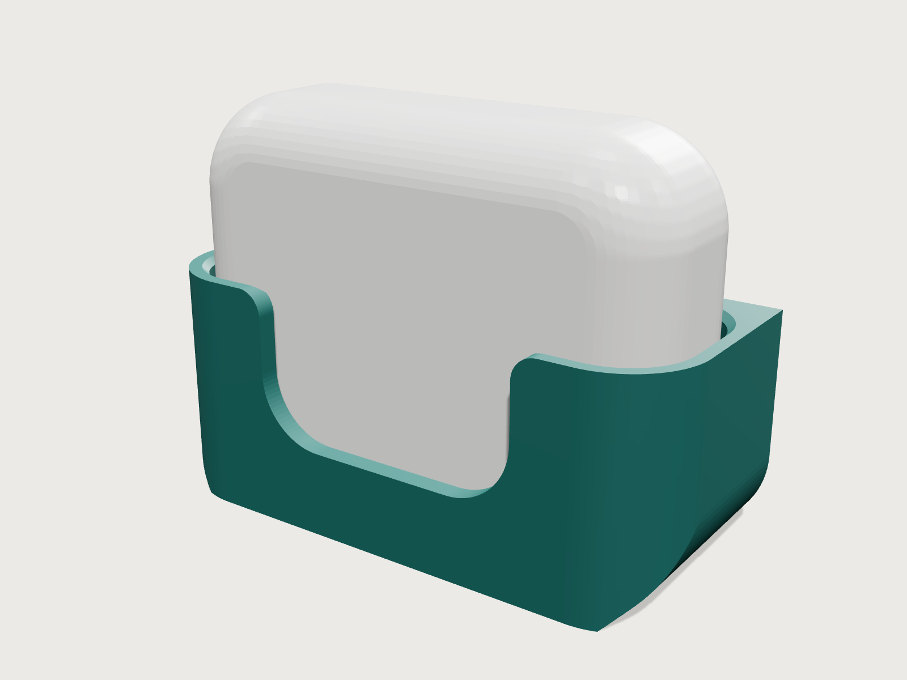

# AirPods Pro 3 Halter fürs Bett

Halter für das Ladecase der AirPods Pro 3 (Case-Maße laut Apple: 62,2 × 47,2 × 21,8 mm).
Es gibt ihn in drei Varianten: zum Ankleben, zum Anschrauben oder zum Einhängen über den Bettrahmen.



## Dateien

| Datei | Wofür |
|---|---|
| `stl/AirPods-Pro-3-Halter_Klebeband.stl` | flache Rückseite für doppelseitiges Klebeband |
| `stl/AirPods-Pro-3-Halter_Schraube.stl` | 2 versenkte Schraubenlöcher in der Rückwand |
| `stl/AirPods-Pro-3-Halter_Bettrahmen-Clip_18mm.stl` | Clip für 18 mm dicke Rahmen/Kopfteile |
| `stl/AirPods-Pro-3-Halter_Bettrahmen-Clip_22mm.stl` | Clip für 22 mm |
| `stl/AirPods-Pro-3-Halter_Bettrahmen-Clip_25mm.stl` | Clip für 25 mm |
| `stl/AirPods-Pro-3-Halter_Bettrahmen-Clip_30mm.stl` | Clip für 30 mm |
| `airpods_pro3_halter.scad` | parametrische Quelle (OpenSCAD, MakerWorld Parametric Model Maker) |
| `bilder/` | Vorschaubilder für die Modellseite |

---

## Text für MakerWorld

**Titel:** AirPods Pro 3 Halter fürs Bett – Kleben, Schrauben oder Einhängen

**Beschreibung:**

Ein schlichter Halter für das Ladecase der AirPods Pro 3, damit das Case nachts direkt am Bett
griffbereit ist statt irgendwo im Bett zu verschwinden.

- **Spalt im Boden:** Staub und Krümel fallen durch und sammeln sich nicht im Halter.
  Durch den Spalt ist auch der Lautsprecher (Wo ist?) gut zu hören.
- **Deckel geht im Halter auf:** Die Wände enden unterhalb der Deckelfuge. Du kannst also
  das Case aufklappen und die AirPods reinlegen, ohne es herauszunehmen.
- **Ausschnitt vorne:** Zum Greifen, und die Status-LED bleibt sichtbar.
- **Einführschräge** oben, damit das Case leicht hineinrutscht.

**Drei Varianten:**

1. **Klebeband:** Die Rückseite ist komplett flach (ca. 68 × 28 mm Klebefläche).
   Empfehlung: Montageklebeband / VHB-Schaumklebeband.
2. **Schrauben:** Zwei Löcher für Senkkopfschrauben (3,5–4 mm) in der Rückwand. Mit dem
   Schraubendreher kommst du durch den vorderen Ausschnitt an die Schrauben. Die Köpfe
   sitzen versenkt und kratzen das Case nicht an.
3. **Bettrahmen-Clip:** Wird einfach über den Bettrahmen oder das Kopfteil gehängt, ohne
   Kleben und ohne Bohren. Dafür sind Dateien für 18, 22, 25 und 30 mm Rahmenstärke dabei.
   Für jede andere Stärke kannst du den Wert `rahmen_dicke` im Parametric Model Maker anpassen.

**Druckeinstellungen:**

- Material: PLA oder PETG
- Schichthöhe: 0,2 mm
- Wände: 3–4, Infill: 15–20 %
- **Keine Stützen nötig.** So drucken, wie die Datei liegt (Boden auf dem Druckbett).
- Beim Clip wird der obere Steg frei überbrückt (je nach Rahmenstärke ca. 19–31 mm).
  Das schaffen aktuelle Drucker normalerweise problemlos.

**Hinweise:**

- Für das Case ohne Hülle ist pro Seite 0,5 mm Spiel eingerechnet. Benutzt du eine
  Schutzhülle, stell im Parametric Model Maker `huelle` auf deren Wandstärke (z. B. 1,0 mm).
- Ist die Passung zu stramm oder zu locker, kannst du sie über `spiel` anpassen.

**Parameter im Parametric Model Maker:** Befestigungsart, Rahmenstärke, Clip-Spiel,
Schraubengröße und -abstand, Spiel, Hüllendicke, Wandhöhe, Spaltbreite und -länge sowie
die Größe des Front-Ausschnitts.

---

## Selbst rendern

```bash
openscad -o halter.stl -D 'befestigung="clip"' -D rahmen_dicke=25 airpods_pro3_halter.scad
```

`befestigung` kann `"klebeband"`, `"schraube"` oder `"clip"` sein.
